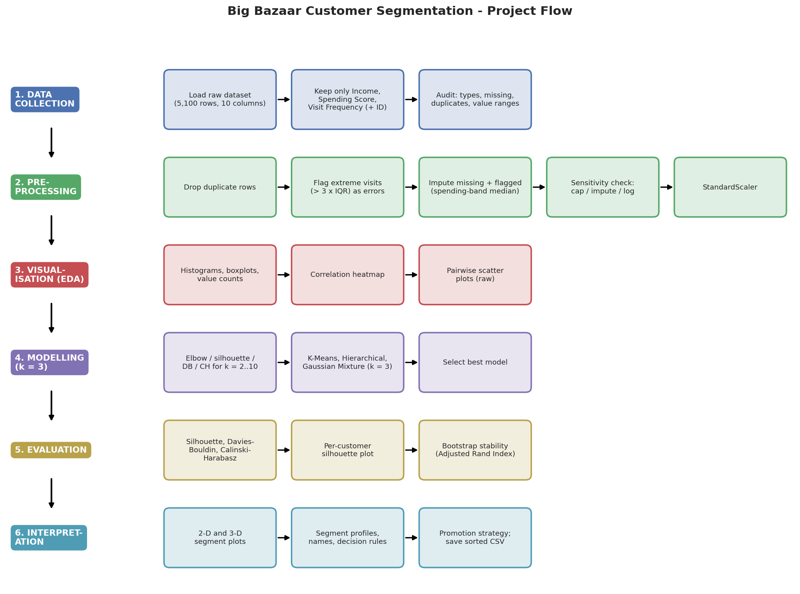
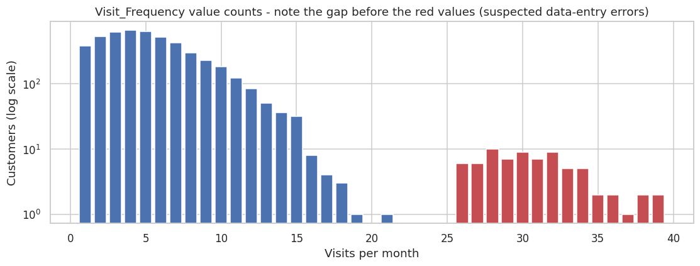
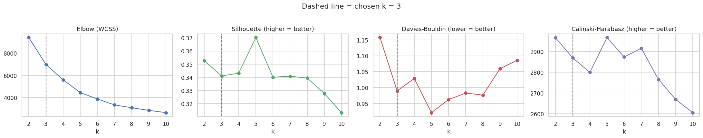
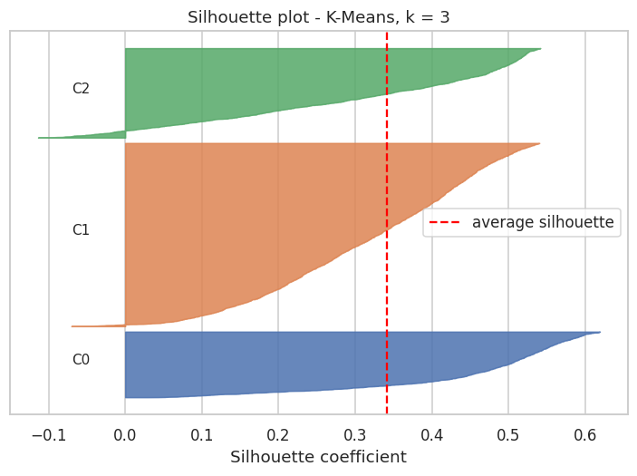
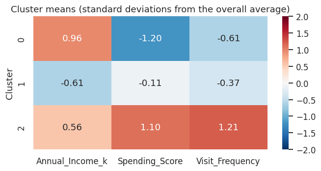
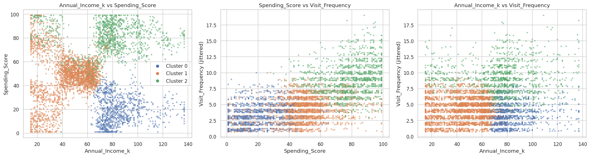
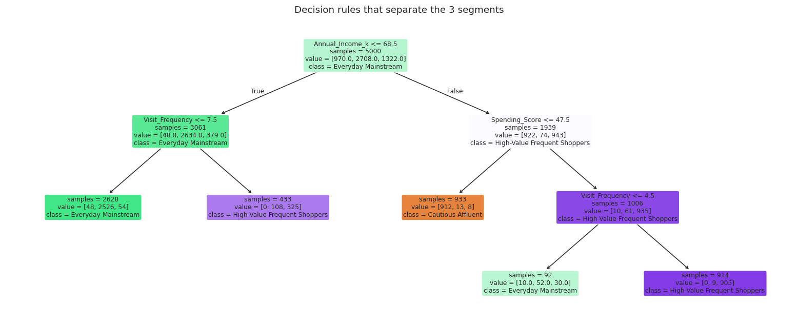

# Big Bazaar Customer Segmentation

*Made with ❤️ by Prakarsh· Part of the AI for Engineers Coursework*

A clustering project that groups **5,000 retail customers into 3 segments** using only their income, spending score and store-visit frequency, then suggests a promotion strategy for each segment.

> **Problem statement:** Big Bazaar runs the same promotions for almost every shopper, which wastes budget on customers who would buy anyway and misses customers who need a different offer. Group customers into 3 distinct segments from three purchase-related variables, and recommend a promotion strategy for each.

## Results at a glance

**K-Means with k = 3**, trained on three scaled features after cleaning the raw 5,100-row file down to 5,000 customers. It was chosen over Hierarchical (Ward) and Gaussian Mixture clustering because it scored best on Silhouette and Calinski-Harabasz.

| Segment | Customers | Income (k) | Spending score | Visits / month | Promotion strategy |
| --- | --- | --- | --- | --- | --- |
| **High-Value Frequent Shoppers** | 1,322 (26.4%) | 75.0 | 78.7 | 9.1 | VIP loyalty tier, early access, bundles; avoid heavy discounts |
| **Everyday Mainstream** | 2,708 (54.2%) | 44.6 | 47.6 | 4.2 | Loyalty points, weekly deals, category cross-sell |
| **Cautious Affluent** | 970 (19.4%) | 85.5 | 19.4 | 3.5 | Personalised, quality-led offers to raise visit frequency |

| Metric | K-Means (k = 3) |
| --- | --- |
| Silhouette (higher is better) | 0.341 |
| Davies-Bouldin (lower is better) | 0.990 |
| Calinski-Harabasz (higher is better) | 2,869 |
| Bootstrap stability (Adjusted Rand Index) | 0.988 |
| Customers on a segment boundary (negative silhouette) | 2.6% |

**In one sentence:** income alone does not identify good customers: the highest-earning segment (Cautious Affluent) spends least and visits least, so it is the clearest growth opportunity.

All numbers in this README come from the executed notebook [`notebooks/01_customer_segmentation.ipynb`](notebooks/01_customer_segmentation.ipynb) and the files in [`results/`](results) and [`data/processed/`](data/processed).

---

## Contents

- [The problem](#the-problem)
- [Dataset](#dataset)
- [Approach](#approach)
- [Results](#results)
- [Interpretation: who are the segments?](#interpretation-who-are-the-segments)
- [How to run it](#how-to-run-it)
- [Limitations](#limitations)
- [Future work](#future-work)
- [Project structure](#project-structure)

---

## The problem

- **Input:** three numbers per customer.
- **Output:** one of three segments, plus a promotion strategy for each.

| Variable | Meaning |
| --- | --- |
| `Annual_Income_k` | Annual income (thousands) |
| `Spending_Score` | Spending score, 1-100 |
| `Visit_Frequency` | Store visits per month |

**Scope decisions:** only these three variables are used (Age, Gender, Basket Value, Recency, Promo Response and Preferred Category are dropped), and the number of segments is fixed at **k = 3**. Elbow and silhouette analysis are still run to check how k = 3 compares with other choices.



## Dataset

The raw file [`data/raw/bigbazaar_hybrid_raw_5k.csv`](data/raw/bigbazaar_hybrid_raw_5k.csv) was **generated for this project** (it is not real Big Bazaar data):

- `Annual_Income_k` and `Spending_Score` (plus Age and Gender, not used here) are resampled from the public **Mall Customers** dataset (Kaggle, 200 real customers) with small random noise, to scale it up to 5,000 customers.
- `Visit_Frequency` (and the other behavioural columns, not used here) is simulated from those columns with a fixed random seed.
- Realistic data problems (missing values, outliers, duplicate rows) were added so the cleaning step is meaningful.

What the audit found:

| | |
| --- | --- |
| Raw rows | **5,100** (5,000 customers + 100 duplicate rows) |
| Missing values | 206 `Visit_Frequency` values (4.04%); 200 remain after duplicates are removed |
| Suspicious values | 72 `Visit_Frequency` values above 19 visits/month. Genuine values end around 21 and a separate group starts at 26, with an empty gap between |
| Income and spending score | complete and in valid range; the high incomes (up to 137k) are genuine |



## Approach

**1. Clean the data** (see [Section 5 of the notebook](notebooks/01_customer_segmentation.ipynb)):

| Step | Method | Reason |
| --- | --- | --- |
| 1 | Drop duplicate rows | Duplicates would count some customers twice |
| 2 | Treat `Visit_Frequency` above the **3 × IQR fence (19)** as data-entry errors | A 1.5 × IQR rule would flag 153 values, including genuine heavy visitors |
| 3 | Impute missing values with the **median of the customer's spending-score band** | On hidden values, the band median had an error of 1.93 visits vs 2.40 for one global median |
| 4 | Keep income and spending score unchanged | Complete, valid, and the high incomes are genuine |
| 5 | Sensitivity check (capping vs imputing, log transform) | Confirms the cleaning choices do not drive the result |
| 6 | `StandardScaler` | Clustering uses distances, so features need a common scale |

**2. Check the number of clusters.** K-Means is run for k = 2 to 10 (elbow, silhouette, Davies-Bouldin, Calinski-Harabasz), plus a bootstrap stability test.

**3. Compare three models at k = 3** on the same scaled data: K-Means, Hierarchical (Ward) and Gaussian Mixture. The best model is chosen by silhouette score.

**4. Evaluate** with the three internal metrics, a per-customer silhouette plot and bootstrap stability (80% subsamples, 30 repeats, Adjusted Rand Index).

**5. Interpret:** profile and name the segments, derive plain-English rules with a shallow decision tree, and map each segment to a promotion strategy.

## Results

### Is k = 3 a good choice?

| k | Silhouette | Davies-Bouldin | Calinski-Harabasz | Stability (ARI) |
| --- | --- | --- | --- | --- |
| 2 | 0.353 | 1.157 | 2,966 | 0.974 |
| **3** | **0.341** | **0.990** | **2,869** | **0.988** |
| 4 | 0.343 | 1.029 | 2,799 | 0.865 |
| 5 | 0.370 | 0.921 | 2,968 | 0.985 |
| 6 | 0.340 | 0.962 | 2,873 | 0.880 |



The metrics sit in a narrow band. **k = 5 is marginally the best statistically** (it matches the five dense blocks in the income vs spending plot), but **k = 3 is much more reproducible than its neighbours k = 4 and k = 6** (ARI 0.988 vs about 0.87 to 0.88). The price of k = 3 is that natural blocks get merged into broader segments.

### Model comparison (k = 3)

| Model | Silhouette | Davies-Bouldin | Calinski-Harabasz |
| --- | --- | --- | --- |
| **K-Means** | **0.341** | 0.990 | **2,869** |
| Hierarchical (Ward) | 0.291 | **0.962** | 2,112 |
| Gaussian Mixture | 0.294 | 1.210 | 2,065 |

K-Means wins on two of three metrics. The three models agree only moderately with each other (ARI 0.55 to 0.59), because customers form a continuous spread rather than isolated islands, so segment boundaries are soft whichever algorithm is used.

### Segment quality

| | Cluster 0 | Cluster 1 | Cluster 2 |
| --- | --- | --- | --- |
| Average silhouette | 0.453 | 0.317 | 0.308 |

An overall silhouette of 0.34 means a reasonable but not sharp structure, which is typical for customer behaviour data.

| Silhouette plot | Segment heatmap |
| --- | --- |
|  |  |



### Does the data cleaning matter?

Agreement with the chosen pipeline (Adjusted Rand Index, 1 = identical segments):

| Variant | ARI vs chosen |
| --- | --- |
| Leave the 72 extreme values untouched | 0.808 |
| Cap at 1.5 × IQR | 0.968 |
| Cap at 3 × IQR | 0.916 |
| **Impute above 3 × IQR (chosen)** | 1.000 |
| Impute + log transform | 0.408 |

Leaving the errors in changes the segments noticeably, but whether they are capped or imputed barely matters. A log transform reshuffles many customers, so `Visit_Frequency` stays on its original scale (which is also easier to explain as "visits per month").

## Interpretation: who are the segments?

Each segment is named from its standardised averages (high = more than +0.5 SD, low = less than -0.5 SD compared with all customers).

- **Cautious Affluent (19.4%)**: the highest earners (about 85k) with the lowest spending score (about 19) and the fewest visits (3.5/month). They have the money but are not spending it in the store: the biggest untapped opportunity.
- **Everyday Mainstream (54.2%)**: the largest and most varied group, with modest income (about 45k), mid spending score (about 48) and about 4 visits per month.
- **High-Value Frequent Shoppers (26.4%)**: spending score about 79 and about 9 visits per month, roughly 2.6 times as often as Cautious Affluent. Their income is spread widely (typically 34k to 104k), so they are defined by behaviour, not income.

**Segregation rules.** A pruned decision tree re-creates the segments from the three raw features with **94.2% cross-validated accuracy**, so marketing staff can apply simple rules without running the model:

1. Income above about 68k **and** spending score up to about 47 → **Cautious Affluent**
2. Income above about 68k, spending score above 47, more than 4 visits/month → **High-Value Frequent Shoppers** (4 or fewer → Everyday Mainstream)
3. Income up to about 68k and more than 7 visits/month → **High-Value Frequent Shoppers**
4. Everyone else → **Everyday Mainstream**



## How to run it

### Setup

```
git clone https://github.com/YOUR-USERNAME/bigbazaar-customer-segmentation.git
cd bigbazaar-customer-segmentation
python3 -m venv .venv
source .venv/bin/activate        # on Windows: .venv\Scripts\activate
pip install -r requirements.txt
```

### Run the notebook

```
cd notebooks
jupyter notebook 01_customer_segmentation.ipynb
```

Run all cells. The notebook reads `data/raw/bigbazaar_hybrid_raw_5k.csv` and rewrites the files in `data/processed/`, `results/` and `docs/`. The random seed is fixed (`SEED = 42`), so a re-run reproduces the same segments.

### Use the segmented customers

[`data/processed/bigbazaar_segmented_3clusters.csv`](data/processed/bigbazaar_segmented_3clusters.csv) lists all 5,000 customers sorted by segment, with columns `CustomerID, Annual_Income_k, Spending_Score, Visit_Frequency, Cluster, Segment`.

## Limitations

- **Synthetic data.** The 5,000 rows were generated from 200 real customers with added noise, and `Visit_Frequency` was simulated mainly from spending score. The results demonstrate the method; they are **not findings about real Big Bazaar customers**. The bootstrap stability is likely to be optimistic for the same reason.
- **k = 3 is a simplification.** The data shows about five natural blocks, and silhouette is slightly higher at k = 5 (0.370). Everyday Mainstream (54% of customers) mixes several kinds of lower-income shopper.
- **Moderate separation.** A silhouette of 0.34 means neighbouring segments overlap; 2.6% of customers sit on a boundary.
- **Imputed visits.** 272 `Visit_Frequency` values (200 originally missing plus 72 errors) are estimates, so those customers' segments rest mostly on income and spending score.
- **Static snapshot.** Customers move between segments, so the segmentation should be refreshed periodically.

## Future work

- **Try k = 5** for finer targeting, and compare the promotion strategies it would imply.
- **Validate on real data**, since the current file is simulated.
- **Test the strategies.** Run a small A/B promotion test per segment to check that the suggested offers actually work.
- **Add the dropped features** (basket value, recency, promo response, preferred category) to see whether segments become sharper.
- **A simple demo app** (e.g. Streamlit): enter income, spending score and visits, see the segment and its strategy.

## Project structure

```
bigbazaar-customer-segmentation/
├── README.md                         this file
├── PLAN.md                           the project plan, phase by phase
├── requirements.txt                  dependencies
├── .gitignore
├── data/
│   ├── raw/
│   │   └── bigbazaar_hybrid_raw_5k.csv          generated raw data (5,100 rows, 10 columns)
│   └── processed/
│       ├── bigbazaar_raw_3features.csv          the 3 kept features + CustomerID
│       └── bigbazaar_segmented_3clusters.csv    final customers sorted by segment
├── notebooks/
│   └── 01_customer_segmentation.ipynb   the full analysis, start to finish
├── results/                          metrics tables and plots from the run
│   ├── model_comparison.csv
│   ├── segment_summary.csv
│   └── *.png
└── docs/
    └── flow_diagram.png              project flow diagram
```

## Acknowledgements

- Original data: the public **Mall Customers** dataset on Kaggle (200 customers), used as the base for the generated file.
- Built with pandas, NumPy, scikit-learn, SciPy, Matplotlib and seaborn.
